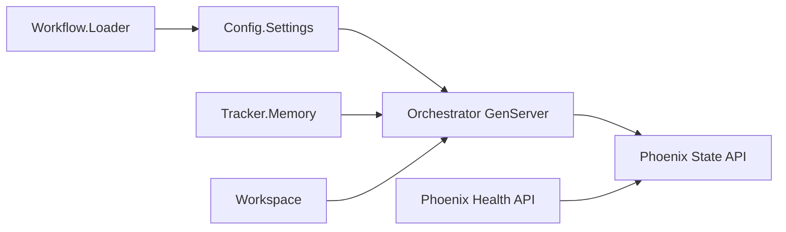

# Symphony Phoenix Phase 1 Design

## Status

Approved direction for Phase 1. Implementation has not started.

## Goal

Build a new Elixir/OTP + Phoenix implementation of Symphony in a separate `phoenix/` directory, using `SPEC.md` as the source of truth and the existing `elixir/` directory only as behavioral reference.

Phase 1 establishes a testable core application skeleton without Linear or real Codex integration. It should prove that the project can load workflow configuration, expose typed settings, manage basic per-issue workspace paths, own an OTP orchestrator state process, and serve minimal Phoenix observability endpoints.

## Scope

### In Scope

- Create a new `phoenix/` project directory.
- Keep core runtime logic independent from Phoenix web modules.
- Add `Workflow.Loader` behavior for `WORKFLOW.md` discovery, YAML front matter parsing, prompt extraction, and documented error classes.
- Add `Config` typed settings with Phase 1 defaults and dispatch preflight validation.
- Add `Tracker.Memory` for deterministic local tests.
- Add `Workspace` basics:
  - derive workspace keys from issue identifiers by replacing characters outside `[A-Za-z0-9._-]` with `_`
  - resolve per-issue paths under the configured workspace root
  - create/reuse workspace directories
- Add `Orchestrator` as an OTP GenServer that owns a runtime state struct and can expose a snapshot.
- Add Phoenix endpoints:
  - `GET /health`
  - `GET /api/v1/state`
- Add tests for each Phase 1 behavior.
- Commit Phase 1 once tests pass, then pause for user confirmation before Phase 2.

### Out of Scope

- Linear GraphQL integration.
- Real Codex app-server subprocess integration.
- Retry/backoff scheduling behavior beyond preserving state fields for later phases.
- Terminal workspace cleanup.
- Workspace hook execution.
- LiveView dashboard.
- Token accounting and rate-limit reporting.
- SSH/remote worker support.

These are deferred to later phases in `task_plan.md`.

## Directory Structure

Recommended top-level shape:

```text
phoenix/
  config/
  lib/
    symphony/
      application.ex
      workflow/
        loader.ex
      config/
        settings.ex
      tracker/
        behaviour.ex
        memory.ex
      workspace.ex
      orchestrator.ex
      orchestrator/
        state.ex
    symphony_web/
      controllers/
        health_controller.ex
        state_controller.ex
      endpoint.ex
      router.ex
  test/
    symphony/
    symphony_web/
  mix.exs
```

Module names should use a new application namespace, `Symphony`, not `SymphonyElixir`, so the implementation is clearly separate from the reference implementation.

## Architecture

The implementation should be OTP-first. `Symphony.Orchestrator` is the single authority for runtime scheduling state. It should not depend on Phoenix modules. Phoenix reads state through a public snapshot API exposed by the core runtime.



The Phase 1 orchestrator does not need to poll or dispatch real workers yet. It should initialize from config, store runtime fields that match the spec shape where practical, and expose a deterministic snapshot for tests and the API.

## Data Model

Phase 1 should introduce only the domain structs needed by tests:

- `Symphony.Tracker.Issue`
  - `id`
  - `identifier`
  - `title`
  - `description`
  - `priority`
  - `state`
  - `branch_name`
  - `url`
  - `labels`
  - `blocked_by`
  - `created_at`
  - `updated_at`
- `Symphony.Config.Settings`
  - `tracker`
  - `polling`
  - `workspace`
  - `hooks`
  - `agent`
  - `codex`
- `Symphony.Orchestrator.State`
  - `poll_interval_ms`
  - `max_concurrent_agents`
  - `running`
  - `claimed`
  - `retry_attempts`
  - `completed`
  - `codex_totals`
  - `codex_rate_limits`

The structs can be minimal but should preserve the spec's naming so later phases can extend them without churn.

## Configuration

Phase 1 should support the core defaults listed in `SPEC.md`:

- `tracker.kind`: required for dispatch validation; `memory` is allowed for tests and local MVP.
- `tracker.endpoint`: default Linear endpoint.
- `tracker.api_key`: literal or `$VAR_NAME`; empty env value is missing.
- `tracker.project_slug`: required only for Linear.
- `tracker.active_states`: default `["Todo", "In Progress"]`.
- `tracker.terminal_states`: default `["Closed", "Cancelled", "Canceled", "Duplicate", "Done"]`.
- `polling.interval_ms`: default `30000`.
- `workspace.root`: default `<system-temp>/symphony_workspaces`; `~`, `$VAR`, and relative-to-workflow-file resolution should be supported.
- `hooks.timeout_ms`: default `60000`.
- `agent.max_concurrent_agents`: default `10`.
- `agent.max_turns`: default `20`.
- `agent.max_retry_backoff_ms`: default `300000`.
- `agent.max_concurrent_agents_by_state`: default `%{}`.
- `codex.command`: default `codex app-server`.
- `codex.turn_timeout_ms`: default `3600000`.
- `codex.read_timeout_ms`: default `5000`.
- `codex.stall_timeout_ms`: default `300000`.

Codex approval and sandbox values should be accepted as pass-through config values. Phase 1 does not need to validate Codex protocol-specific enums.

## Error Handling

Phase 1 should use explicit error tuples matching the spec where applicable:

- `{:missing_workflow_file, path, reason}`
- `:workflow_front_matter_not_a_map`
- `{:workflow_parse_error, reason}`
- `{:invalid_workflow_config, message}`
- `:missing_tracker_kind`
- `{:unsupported_tracker_kind, kind}`
- `:missing_linear_api_token`
- `:missing_linear_project_slug`

Phoenix endpoints should not expose stack traces. `/health` can return a simple healthy status when the app is running. `/api/v1/state` should return an error JSON if the orchestrator snapshot is unavailable.

## Testing Strategy

Use ExUnit and TDD for Phase 1:

- Workflow loader tests:
  - prompt-only file
  - YAML front matter with body
  - missing file error
  - non-map front matter error
- Config tests:
  - defaults
  - `$VAR` secret/path resolution
  - relative workspace root resolved from workflow file directory
  - Linear preflight validation errors
  - memory tracker validation success
- Workspace tests:
  - identifier sanitization
  - workspace path remains under root
  - directory create/reuse behavior
- Orchestrator tests:
  - starts under supervision
  - initializes configured poll interval and concurrency
  - returns a spec-shaped snapshot
- Phoenix tests:
  - `GET /health`
  - `GET /api/v1/state`

Phase 1 exit requires all Phase 1 tests to pass and a git commit to be created.

## Phase 1 Acceptance Criteria

- `phoenix/` exists and contains a clean new Elixir/Phoenix implementation.
- `mix test` passes from `phoenix/`.
- The app can boot under Mix.
- `/health` and `/api/v1/state` are covered by tests.
- No code is copied wholesale from `elixir/`.
- A git commit records the completed Phase 1 implementation.
- Work pauses after Phase 1 for user confirmation before Phase 2.
