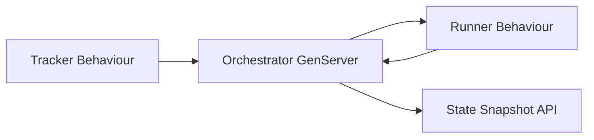

# Symphony Phoenix Phase 2 Design

## Status

Phase 2 starts from the completed Phase 1 Core OTP MVP.

## Goal

Implement the core scheduling semantics from `SPEC.md` inside the new Phoenix/OTP implementation,
using the memory tracker and a fake in-process runner. Phase 2 must make the orchestrator own real
claim/running/retry/completed transitions without integrating Linear or Codex.

## Scope

### In Scope

- Candidate issue eligibility:
  - required `id`, `identifier`, `title`, and `state`
  - active state inclusion
  - terminal state exclusion
  - not already running
  - not already claimed
  - global concurrency slots
  - per-state concurrency slots
  - `Todo` blocker rule for non-terminal blockers
- Candidate sort order:
  - priority ascending, with `nil` last
  - `created_at` oldest first
  - `identifier` lexicographic tie-breaker
- Orchestrator state transitions:
  - claim issue before dispatch
  - move claimed issue to running
  - complete normally and schedule short continuation retry
  - retry abnormal exits with exponential backoff
  - release claims when retry no longer finds a candidate
- Retry/backoff:
  - continuation delay: `1000` ms
  - failure delay: `min(10000 * 2^(attempt - 1), max_retry_backoff_ms)`
  - retry state contains `issue_id`, `identifier`, `attempt`, `due_at_ms`, and `error`
- Active-run reconciliation:
  - terminal issues stop worker and release claim
  - non-active/non-terminal issues stop worker and release claim
  - active issues update the running issue snapshot
- Test runner:
  - fake runner process for deterministic tests
  - no Codex subprocess
  - no workspace mutation beyond Phase 1 APIs

### Out of Scope

- Linear GraphQL adapter.
- Codex app-server client.
- Real workspace hook execution.
- Stall detection based on Codex event timestamps.
- Startup terminal workspace cleanup.
- SSH/remote workers.
- Dashboard enhancements beyond returning the expanded state snapshot.

## Architecture

Phase 2 keeps `Symphony.Orchestrator` as the only process that mutates scheduling state. It accepts
injected tracker and runner modules through `start_link/1` options for deterministic tests.

The runner contract is intentionally small for Phase 2:

- `start_issue(issue, opts)` starts work and returns `{:ok, pid}`.
- The runner process exits normally or abnormally.
- The orchestrator monitors the process and converts `:DOWN` messages into state transitions.

Later Codex integration can replace the fake runner behind the same boundary.

## State Model

`Symphony.Orchestrator.State` keeps the Phase 1 fields and adds runtime-support fields as needed:

- `tracker`
- `runner`
- `settings`
- `running`
- `claimed`
- `retry_attempts`
- `completed`

`running` entries should include:

- `issue`
- `identifier`
- `state`
- `pid`
- `monitor_ref`
- `started_at_ms`
- `attempt`

`retry_attempts` entries should include:

- `issue_id`
- `identifier`
- `attempt`
- `due_at_ms`
- `timer_ref`
- `error`

The public snapshot should remain JSON-safe.

## Testing Strategy

Use ExUnit and TDD:

- unit tests for issue sorting and eligibility
- GenServer tests for dispatch and concurrency
- GenServer tests for normal completion and failure retry
- GenServer tests for retry release when an issue is absent
- GenServer tests for active/terminal/non-active reconciliation

Tests should use `Symphony.Tracker.Memory` and a new fake runner module under `test/support`.

## Acceptance Criteria

- Phase 2 tests pass.
- Existing Phase 1 tests still pass.
- `mix format` passes.
- `mix test` passes.
- Phase 2 implementation is committed.
- Work pauses for confirmation before Phase 3.

